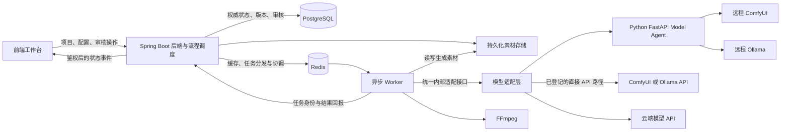

# 系统架构设计

## 设计状态

本文件为 P0-01 的架构边界，不代表组件已经实现或部署。采用 Monorepo，首版后端按业务模块组织为单体，长任务交给独立 Worker；模型代理与 GPU 服务独立部署。避免在任务未授权时提前建立微服务、通用编排平台或第二套执行引擎。

## 组件关系

直接 API 与 Agent 是可选连接方式，不强制同一请求经过两条路径。适配层属于执行侧逻辑边界，其物理位置在后续接口任务中确定。

## 模块职责

| 模块 | 职责 | 边界 |
| --- | --- | --- |
| frontend | React/Vite/Ant Design 工作台、React Flow 画布、预览、编辑与审核入口 | 不执行工作流，不直接连接 GPU 或携带供应商密钥 |
| backend | 项目权限、剧本资产、模型配置、节点依赖、审核、状态机、版本及调度 | 唯一权威业务状态写入方；执行结果必须校验后落库 |
| PostgreSQL | 保存配置、流程实例、尝试、审核与素材关系 | 业务恢复的事实来源；使用持久化存储和备份 |
| Flyway | 版本化数据库迁移 | SQL 源码集中在 database/migrations，后端构建时打包；本次不创建业务迁移 |
| Redis | 缓存、任务通知、锁与运行协调 | 不能代替数据库保存唯一任务状态；协议及可靠性策略待后续实现 |
| worker | 领取任务、调用适配器、跟踪长任务、搬运素材、执行 FFmpeg、回报进度和结果 | 不自行审批或解锁下游，不维护第二份权威状态；语言待定 |
| model-agent | Python/FastAPI，模型机健康检查、任务执行、已登记服务的受控管理 | 不提供任意 Shell 命令；不管理项目业务与审核 |
| ComfyUI | 按模板执行图片和视频生成 | 平台注入映射参数、记录外部任务 ID、取回输出；服务自身历史不是平台持久化替代品 |
| Ollama | 执行自部署语言模型推理 | 通过已登记端点调用，资源调度受 GPU 能力约束 |
| 云端 API | 语言、图片、视频或语音生成 | 各协议独立适配；调用记录、超时核实及凭据在服务端管理 |
| FFmpeg | 按已确认顺序和参数处理音频字幕、合成与编码 | 由 Worker 调用，结果回写素材存储并进入成片审核 |
| 素材存储 | 持久保存图片、视频、音频及导出文件 | 数据库保存引用和元数据，文件访问通过权限控制 |

## 流程与执行模型

流程模板描述节点与依赖；流程运行实例记录某次制作；节点运行记录执行与审核进度；任务尝试记录模型调用与重试；素材版本和审核记录独立保存。此处是概念模型，本阶段不创建数据库业务表。

基本执行顺序：

1. 后端验证权限、输入和依赖，持久化待执行记录。
2. 将可执行任务分发给 Worker。数据库事务与队列投递之间需要可靠投递/补偿机制，后续任务实现并验证，不能假定两者原子成功。
3. Worker 以任务 ID、尝试 ID 执行，记录供应商或 ComfyUI 外部任务 ID，回报心跳、进度、错误与输出。
4. 后端校验当前尝试及状态，持久化素材版本。需要审核的产物进入待审核，生成成功不直接解锁下游。
5. 审核操作绑定具体版本；通过后后端重新判断依赖，启动下游。
6. 全部必需分镜完成后，按规划顺序进行音频字幕与合成；成片审核通过后允许导出。

数据库记录与执行侧文件写入也需要一致性处理：文件存在不代表任务完成，任务完成前必须确认文件保存成功。Redis 丢失通知、Worker 崩溃或后端重启时，依据数据库未完成任务与外部任务状态核实恢复，避免重复提交。

## 审核、版本与局部返工

- 人物、场景、分镜使用稳定 ID；名称和文件名不能作为唯一关联依据。
- 每次重新生成创建素材新版本，保存输入引用、提示词和模型配置快照。
- 审核只对特定版本有效。视频应引用实际使用的首帧版本，成片应引用实际合成的分镜版本。
- 图片 v1 通过后重生成 v2，v2 必须重新审核；基于 v1 的视频保留，并标明其来源。
- 图片驳回重做对应生图节点；视频驳回重做对应视频节点；合成参数问题只重跑合成。修改上游素材时由后端标记受影响的下游，不静默覆盖或自动认定有效。
- 逻辑上可有 N 条并行支线；实际并发由执行资源、服务配额和队列限制，不能由画布分支数决定。

## 模型统一适配

内部统一任务输入、能力、状态查询、结果和错误语义；底层分别支持同步文本响应、异步媒体任务和 ComfyUI 工作流。具体 DTO/API 契约在后续阶段定义。

每个生成节点保存模型配置及凭据引用。以部署类型、协议和能力判断执行路径，不能只看 API Key 是否为空；远程自部署服务也可能需要认证。

工作流模板必须声明可注入字段、参考资产和模型依赖。服务未就绪、模板缺失或参数不兼容时明确报错。Agent 启动服务后还需健康检查，不能仅根据启动命令返回判断可用。

重试使用独立尝试记录和有限策略。提交超时且结果不确定时先核实外部任务；备用模型切换及费用规则须由后续任务明确配置，不能无条件重复调用。

## 部署与持久化

- 开发时源码放本地 Git 工作区。平台基础服务规划使用 Docker Compose，Windows/Linux 的具体部署步骤在部署阶段验证。
- 模型服务可在同机、其他服务器或 GPU 容器中运行，通过 API/Agent 连接。不能假设远端可运行 Compose、具备 Docker 或 systemd。
- 数据库、素材和重要配置不依赖 GPU 实例临时文件系统。采用持久化卷或可靠外部存储，并制定备份恢复策略；卷持久化不等于备份。
- 数据库文件、模型权重、生成素材与密钥不纳入 Git；仓库只保存源码、迁移及无密钥的配置模板。
- 多用户由后端执行项目权限校验；密钥使用服务端凭据管理，日志脱敏。模型端点通过受控网络连接，不将未鉴权模型管理接口直接作为公网产品入口。

## 规划目录

`frontend/`、`backend/`、`worker/`、`model-agent/`、`contracts/`、`database/migrations/`、`deploy/` 与 `docs/`。本次仅创建文档与工程规范文件，目录将在各自任务中按需落地。
